# Nusantara Mini ERP

[](https://github.com/mfadlikurniawann-webdev/Nusantara-ERP---Odoo/actions/workflows/ci.yml)


A compact, multi-module ERP for an Indonesian staples distributor (UMKM), built from
scratch on **Odoo 20 Community** as a portfolio project: stock ledger with average
cost, sales with credit limits, purchases with tiered approval, invoicing with
partial payments, aging and an OWL dashboard. Six addons, more than a hundred
automated tests, CI with lint and coverage.


## Contents

- [Business case](#business-case)
- [Modules and features](#modules-and-features)
- [Architecture](#architecture)
- [Data model](#data-model)
- [Business flows](#business-flows)
- [Odoo concepts demonstrated](#odoo-concepts-demonstrated)
- [Screenshots](#screenshots)
- [Getting started](#getting-started)
- [Tests, coverage and lint](#tests-coverage-and-lint)
- [Project structure](#project-structure)
- [Documentation](#documentation)
- [Roadmap](#roadmap)

## Business case

**CV Sumber Rejeki** (fictional) distributes staples (_sembako_) around Surabaya from
two warehouses (Surabaya and Sidoarjo). Its daily problems are the ones this ERP
answers:

| Need                                                                                    | Answer in the ERP                                                   |
| --------------------------------------------------------------------------------------- | ------------------------------------------------------------------- |
| Sell rice, oil, sugar and eggs to small shops (_warung_, _toko_, minimarkets) on credit | Sales orders with **per-customer credit limits** (warn or block)    |
| Many staples are VAT exempt, others carry VAT 11%                                       | **Taxes per product**, VAT 11% by default                           |
| Know the real stock and its value in each warehouse                                     | **Stock move ledger**, average cost per company, stock by warehouse |
| Avoid large purchases without control                                                   | **Purchase approval** above a configurable amount                   |
| Follow who owes what, and since when                                                    | **Partial payments**, overdue follow-up and **aging** report        |
| See the business at a glance                                                            | **Dashboard** with KPIs and the sales of the last six months        |

## Modules and features

| Module                                      | Depends on                  | Main features                                                                                                                                                                                    |
| ------------------------------------------- | --------------------------- | ------------------------------------------------------------------------------------------------------------------------------------------------------------------------------------------------ |
| [`nme_base`](nme_base/README.rst)           | `mail`                      | Products, hierarchical categories, units, taxes, payment terms, customer/vendor flags, company settings, **document mixins** (numbering, state machine, cancellation with reason, totals)        |
| [`nme_inventory`](nme_inventory/README.rst) | `nme_base`                  | Warehouses, receipts/deliveries/internal transfers, **immutable stock ledger**, **average cost (AVCO)**, returns, stock adjustments validated by managers, minimum stock cron, delivery slip PDF |
| [`nme_sales`](nme_sales/README.rst)         | `nme_inventory`             | Quotation, sales order, automatic delivery, delivered quantity from the ledger, **credit limit**, own-documents access, quotation PDF and email                                                  |
| [`nme_purchase`](nme_purchase/README.rst)   | `nme_inventory`             | RFQ, purchase order, **tiered approval** with manager activities, automatic receipt valued at the net price, PO PDF and email                                                                    |
| [`nme_invoicing`](nme_invoicing/README.rst) | `nme_sales`, `nme_purchase` | Invoices and bills from orders, **numbering on posting without gaps**, **partial payments**, overdue cron, **aging** SQL view, credit exposure from open invoices                                |
| [`nme_reporting`](nme_reporting/README.rst) | `nme_invoicing`             | **OWL dashboard**, sales analysis with **margin**, purchase analysis, stock by warehouse, **Excel export**, aging PDF                                                                            |

## Architecture

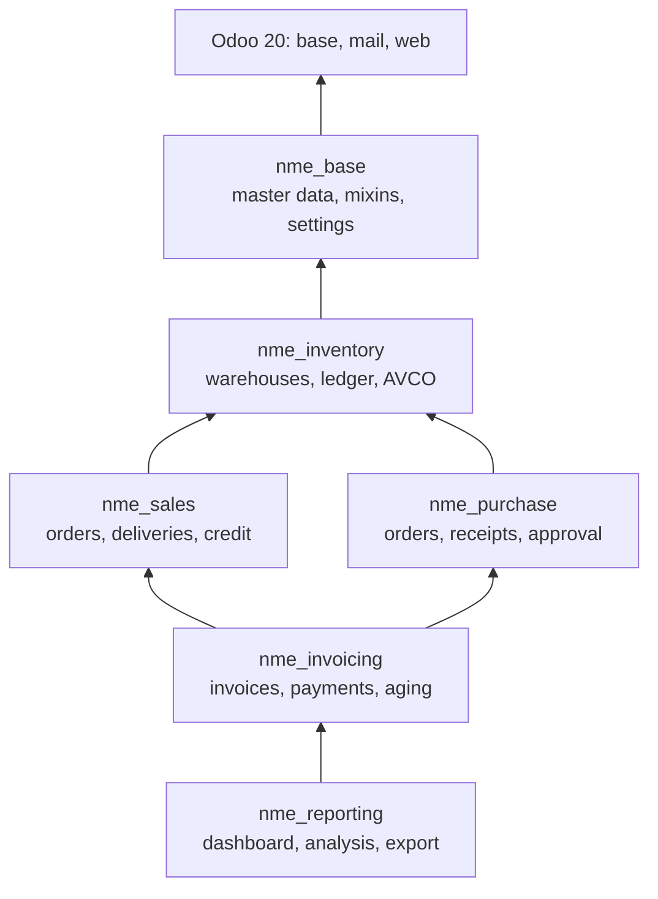

Each layer only knows the layers below it and extends them with `_inherit`: invoicing
adds the invoice status to sales orders, and replaces the order total by the open
invoice balance in the credit exposure computed by `nme_sales`. Every module installs
on its own with its dependencies, with its own security, menus, demo data and tests.

Highlights of the design (details in [docs/ARCHITECTURE.md](docs/ARCHITECTURE.md)):

- **Shared abstract mixins**: one lifecycle for every document (sequence, strict
  `_state_transitions`, cancellation with a reason, chatter) and one priced line
  (price, discount, taxes, amounts) reused by sales, purchase and invoice lines.
- **Stock ledger**: quantities are never stored on products but computed from done
  moves; done moves are immutable, corrections are new moves.
- **Odoo 20 security**: every rule lives in `security/ir.access.csv`; order lines follow
  their order and salespeople read the invoices of their orders through the new
  `access` domain operator, not through `sudo()`.

## Data model

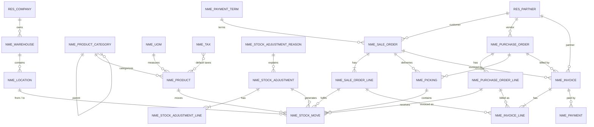

Reporting models (`nme.sale.report`, `nme.purchase.report`, `nme.stock.report`,
`nme.invoice.aging.report`) are PostgreSQL views over these tables.

## Business flows

### Order to cash

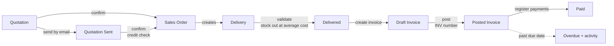

### Procure to pay

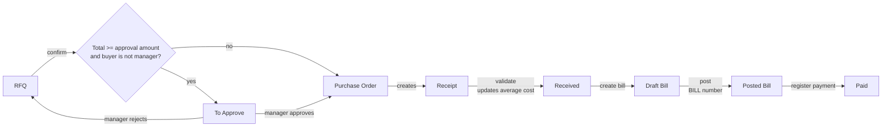

### Document states

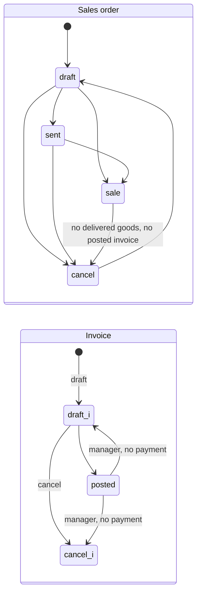

## Odoo concepts demonstrated

| Concept                                                                                                  | Where                                                                                                                           |
| -------------------------------------------------------------------------------------------------------- | ------------------------------------------------------------------------------------------------------------------------------- |
| Classic inheritance (`_inherit`) of core and own models                                                  | `res.partner` (customer/vendor, payment terms, credit limit), `nme.product` extended by inventory, orders extended by invoicing |
| Abstract mixins                                                                                          | `nme.document.mixin`, `nme.trade.document.mixin`, `nme.trade.line.mixin` in `nme_base/models`                                   |
| `mail.thread` / `mail.activity.mixin`, `tracking`, automatic activities                                  | Every document; low stock, purchase approval and overdue invoice activities                                                     |
| Strict state machine                                                                                     | `_state_transitions` + `_set_state` in the document mixin                                                                       |
| Computed fields (stored, non-stored, `precompute`, `company_dependent`), related, `@api.depends_context` | Line amounts, `qty_available`, average cost, credit exposure                                                                    |
| `@api.constrains`, `models.Constraint`, `models.UniqueIndex`                                             | Positive quantities, unique references, overpayment check                                                                       |
| `@api.ondelete(at_uninstall=False)`, `@api.model_create_multi`                                           | Deletion protection of confirmed documents, warehouse creation                                                                  |
| Wizards (`TransientModel`)                                                                               | Cancel with reason, register payment, quick stock adjustment, report export                                                     |
| Smart buttons, kanban (`card`), calendar, pivot, graph                                                   | Orders, transfers, partners, reports                                                                                            |
| Scheduled actions (`ir.cron`)                                                                            | Minimum stock, overdue invoices                                                                                                 |
| QWeb PDF reports and `mail.template`                                                                     | Delivery slip, quotation/order, purchase order, invoice, aging (custom `report.*` model)                                        |
| Server actions bound to list views                                                                       | Mass confirm quotations, validate transfers, post invoices                                                                      |
| `res.config.settings` with company related fields                                                        | Default taxes and terms, quotation validity, purchase approval amount                                                           |
| Security groups with `res.groups.privilege`, `ir.access.csv` permissions and restrictions, multi-company | `security/` of each module                                                                                                      |
| SQL views with `_depends`                                                                                | `nme_reporting/report`, `nme_invoicing/report`                                                                                  |
| OWL 3 client action, Chart.js, Hoot unit test                                                            | `nme_reporting/static`                                                                                                          |
| `TransactionCase` tests with a non-admin test user and `Form`                                            | `tests/` of each module                                                                                                         |

## Screenshots

| Sales order (credit check, delivery and invoice status)    | Purchase order waiting for approval                           |
| ---------------------------------------------------------- | ------------------------------------------------------------- |
| 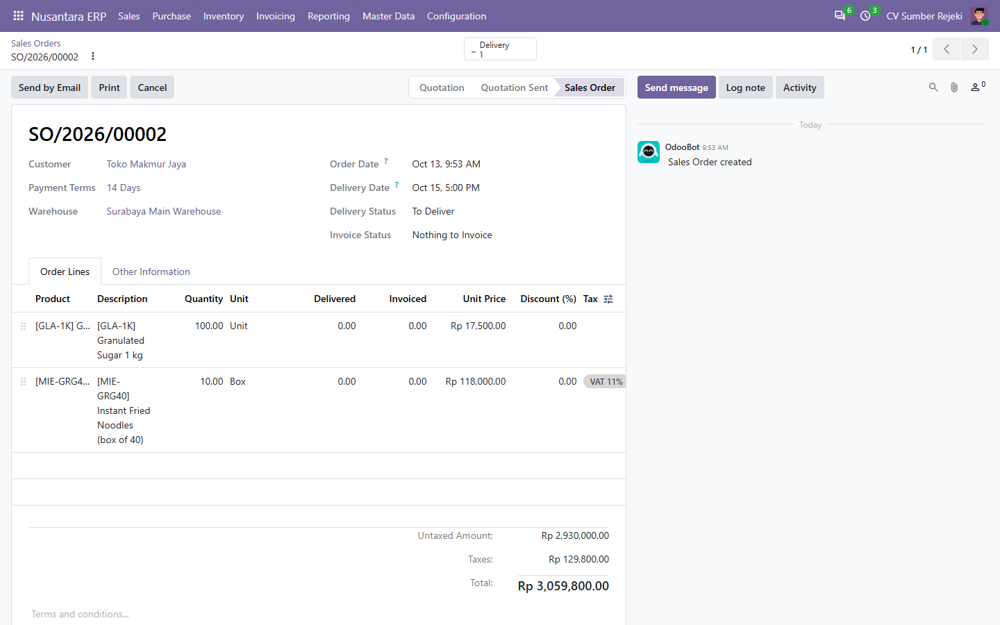            | 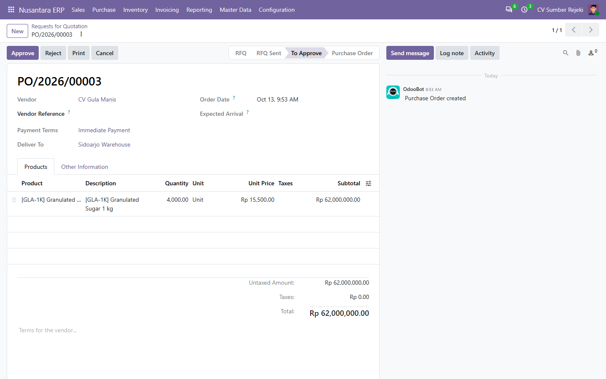  |
| **Stock ledger (immutable moves, values at average cost)** | **Invoice with a partial payment**                            |
| 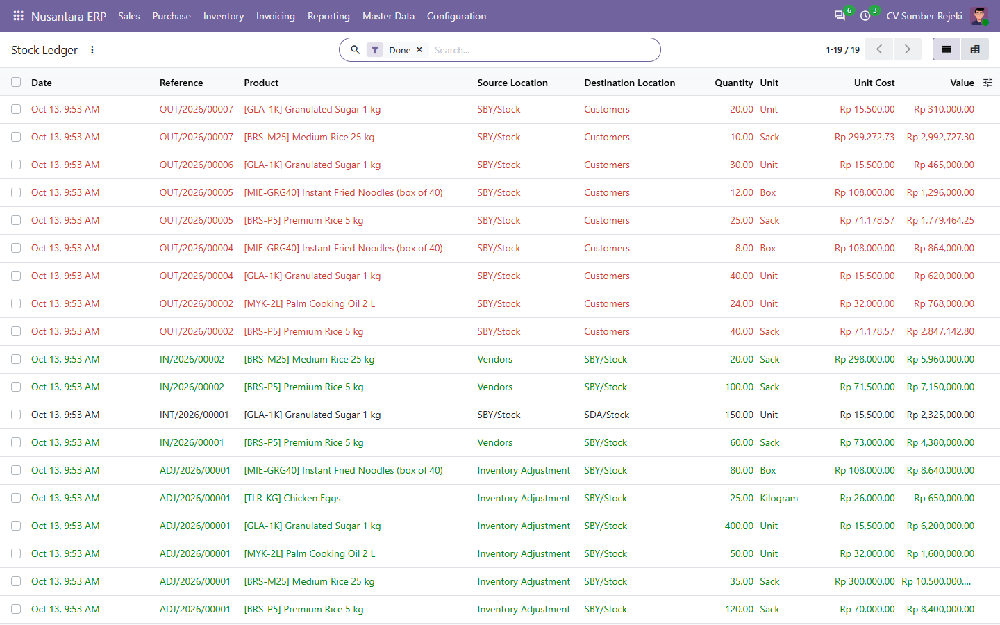         | 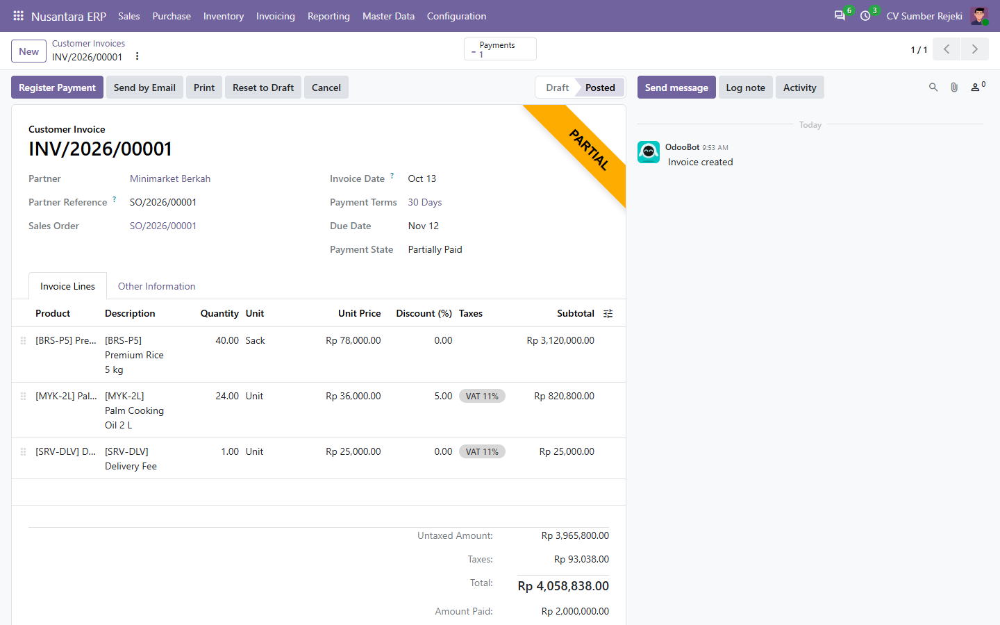              |
| **Receivable aging**                                       | **Dashboard in Bahasa Indonesia (`id.po` translations)**      |
| 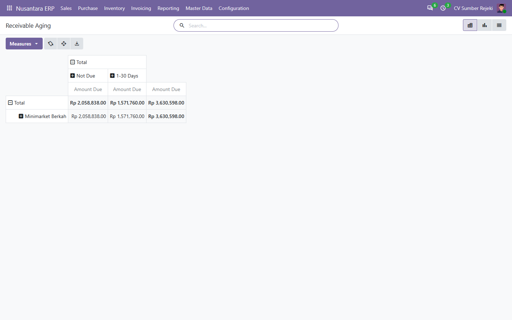                       | 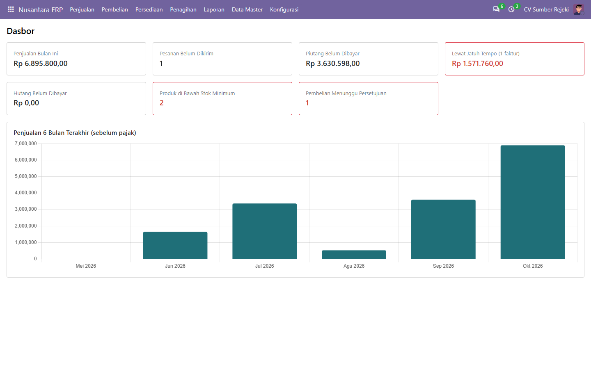 |

Screenshots of the demo database (`--with-demo`), captured with headless Chrome.

## Getting started

### With Docker

```bash
git clone https://github.com/mfadlikurniawann-webdev/Nusantara-ERP---Odoo.git
cd Nusantara-ERP---Odoo
docker compose up -d
make install        # creates database "nme" with all modules and demo data
```

Open http://localhost:8069 and log in with `admin` / `admin`. Set `ODOO_PORT` when
port 8069 is already used. Without `make`, run the commands of the `Makefile`
directly, for example
`docker compose run --rm odoo odoo -d nme -i nme_reporting --with-demo --stop-after-init`.

### Manual installation

1. Get Odoo 20.0 Community and Python 3.12:
   `git clone --depth 1 -b 20.0 https://github.com/odoo/odoo.git`, then
   `pip install -r odoo/requirements.txt` in a virtual environment.
2. Add this repository to the `addons_path` of your `odoo.conf`.
3. Install the top module, which pulls the others:
   `odoo-bin -c odoo.conf -d nme -i nme_reporting --with-demo`.

> **PostgreSQL 18 on Windows**: add `db_template = template1` to `odoo.conf`. Odoo
> creates databases with `LC_COLLATE 'C'` from `template0`, which PostgreSQL 18 refuses
> on Windows when the collation differs from the ctype.

## Tests, coverage and lint

```bash
make test        # fresh database, installs the modules and runs their tests
make coverage    # same, with a coverage report
make lint        # pre-commit: black, isort, flake8, pylint-odoo, prettier
```

Tests never rely on demo data: each test class creates its fixtures, and test methods
run as a regular internal user with only the groups they need (`BaseCommon` of Odoo
20), so access rights are exercised for real. CI (GitHub Actions) runs the lint job
and the test job inside the `odoo:20` image with PostgreSQL 16, then upgrades the
modules, and fails under 80% coverage. Current coverage of the business code: **95%**.

## Project structure

```
nusantara-erp/
├── .github/workflows/ci.yml      lint + test (odoo:20, postgres:16, coverage)
├── docker-compose.yml, docker/   local stack
├── Makefile                      up, down, logs, install, upgrade, test, coverage, lint
├── docs/                         architecture, user guide (Bahasa Indonesia), developer guide
├── nme_base/                     each module: models/, views/, security/, data/, demo/,
├── nme_inventory/                report/, wizard/, i18n/ (id.po), tests/, static/description/
├── nme_sales/
├── nme_purchase/
├── nme_invoicing/
└── nme_reporting/                + static/src (OWL dashboard), static/tests (Hoot)
```

## Documentation

- [Architecture and design decisions](docs/ARCHITECTURE.md)
- [Panduan pengguna (Bahasa Indonesia)](docs/USER_GUIDE.md)
- [Developer guide](docs/DEVELOPER_GUIDE.md)
- [Changelog](CHANGELOG.md)

## Roadmap

- Unit of measure conversions (sack to kg) and backorders for partial deliveries.
- Credit notes and returns invoiced automatically.
- Accounting entries (journal items) behind invoices and stock valuation.
- A second portfolio project customizing the standard `sale`, `stock` and `account`
  apps, which is what most Odoo projects do in practice.

## License and author

[LGPL-3](LICENSE) - M. Fadli Kurniawan
([@mfadlikurniawann-webdev](https://github.com/mfadlikurniawann-webdev))
