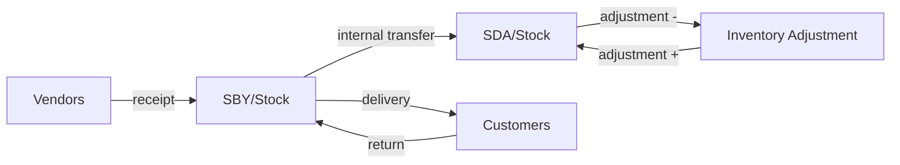

# Architecture and design decisions

This document explains how Nusantara Mini ERP is built and, above all, why. Each
section states a decision, the alternatives considered and the trade-off accepted.

## 1. Six addons with layered dependencies

```
nme_base -> nme_inventory -> nme_sales ----\
                          \-> nme_purchase -+-> nme_invoicing -> nme_reporting
```

**Decision.** Split the ERP into six addons, each owning one business area, and let a
module only depend on the layers below it.

**Why.**

- Each addon can be installed, tested and reviewed on its own. A distributor that only
  needs stock and sales installs `nme_sales` and gets warehouses, products and
  deliveries, nothing else.
- Dependencies document the domain: invoicing needs orders, orders need stock, stock
  needs products. Nothing below knows about what is above.
- Extensions go upward through `_inherit`. `nme_invoicing` adds the invoice status to
  sales orders and refines the credit exposure of `nme_sales`; `nme_reporting` makes
  the dashboard the landing page of the `nme_base` menu.

**Trade-offs.** `nme_invoicing` depends on both sales and purchase, so invoicing cannot
be installed with sales only. A "bridge" module per pair (`nme_sales_invoicing`, ...)
would remove this coupling at the cost of more modules than the business case needs.

**Deviations from the initial brief.** Products live in `nme_base` (the shared line
mixin needs them) and are extended with stock fields by `nme_inventory`; warehouses
live in `nme_inventory`; taxes and payment terms live in `nme_base` because sales and
purchase use them before invoicing exists. PDF reports, email templates and cron jobs
stay in the module that owns the document, so that every module is complete;
`nme_reporting` only holds cross-module analysis.

## 2. Standalone models instead of Odoo's standard apps

**Decision.** Build `nme.*` models instead of extending `sale`, `stock` and `account`.

**Why.** The goal of the project is to show command of the framework itself: models,
ORM, security, views, reports, tests. Re-implementing a focused subset of the flows
makes every design choice visible and explainable.

**Trade-off.** Real Odoo projects mostly customize the standard apps. The roadmap
therefore plans a second project that extends `sale`, `stock` and `account` instead.

## 3. Shared document mixins

Three abstract models in `nme_base` carry the behaviour common to every document:

| Mixin                      | Responsibility                                                                                                                                                                                                                   |
| -------------------------- | -------------------------------------------------------------------------------------------------------------------------------------------------------------------------------------------------------------------------------- |
| `nme.document.mixin`       | Number from `ir.sequence` (`_get_sequence_code`), strict state machine (`_state_transitions` + `_set_state`), cancellation with a reason (`nme.document.cancel` wizard), chatter and activities, deletion only in allowed states |
| `nme.trade.document.mixin` | Partner, payment terms, currency, totals computed from `line_ids`                                                                                                                                                                |
| `nme.trade.line.mixin`     | Product, description, quantity, unit price, discount, taxes and amounts; price and taxes are proposed through `_get_product_price` / `_get_product_taxes`                                                                        |

**State machine.** A document declares its allowed moves:

```python
_state_transitions = {
    "draft": {"sent", "sale", "cancel"},
    "sent": {"sale", "cancel"},
    "sale": {"cancel"},
    "cancel": {"draft"},
}
```

and changes state only through `_set_state()`, which raises a translated error for any
other move. Business checks (delivered goods, posted invoices, payments) are added by
overriding the action methods, not by duplicating the transition logic.

**Numbering.** Documents are numbered at creation, except invoices
(`_sequence_on_create = False`) which get their number when posted from a `no_gap`
sequence: drafts can be deleted freely while posted invoices are numbered without
holes, as Indonesian tax invoices require.

**Computed but editable lines.** Description, unit price and taxes are stored computed
fields with `readonly=False` and `precompute=True`: proposed from the product, still
editable by the user, and computed before the `INSERT` (the description is required).
This replaces `@api.onchange`, which only runs in the UI.

## 4. Stock: a move ledger with average cost

**Decision.** Never store the quantity on hand. Store immutable stock moves between
locations and compute quantities from them.



- **Double entry.** Every move goes from one location to another. Only `internal`
  locations hold stock; Vendors, Customers and Inventory Adjustment are virtual
  counterparts shared by all companies.
- **Quantities** are `SUM(in) - SUM(out)` over done moves, with `_read_group`, for any
  set of locations (a warehouse, a company). Moves between two locations of the set
  cancel out, so internal transfers do not change the company total.
- **Immutability.** A done move cannot be written or deleted. Corrections are new
  moves: returns, adjustments. The ledger is a complete audit trail and gives the stock
  at any past date.
- **No negative stock.** A move leaving an internal location is refused when the
  location does not hold enough.

**Why not a stored quantity per product and location (like `stock.quant`)?** A quant
table is faster on very large volumes but must be kept in sync with the moves, and a
manual edit of a stored quantity loses the history. For a distributor of this size,
grouped queries on indexed moves are fast and the model stays simple. The stock report
is a SQL view on the same moves.

**Average cost (AVCO).** The cost is stored per company (`company_dependent` field,
jsonb column) and updated by every valued incoming move:

```
new_avg = (qty_before x avg_before + qty_in x unit_cost_in) / (qty_before + qty_in)
```

Receipts use the net price of the purchase line (after discount, without taxes),
positive adjustments the cost entered on the line, returned deliveries the cost they
left with. Outgoing moves and transfers are valued at the current average cost and do
not change it. Moves are validated one by one on purpose: each one changes the
quantity and the cost used by the next.

The average cost is updated with `sudo()`: it is a consequence of validating a move,
not a product edit, and stock users have no write access on products.

**Transfers.** Receipts, deliveries and internal transfers are one model
(`nme.picking`) with a type that drives the default locations. Sales and purchase
create them on confirmation; returns reverse the locations of the original transfer
and keep the order links, so delivered and received quantities follow returns.

## 5. Sales, purchase and invoicing policies

- **Invoice policy.** Goods are invoiced on the delivered quantity, services on the
  ordered quantity (`qty_to_invoice`). The same rule applies to vendor bills with
  received quantities.
- **Credit limit.** `res.partner._get_credit_exposure()` is an extension point.
  `nme_sales` counts confirmed orders; `nme_invoicing` replaces their invoiced part by
  the amount still due on invoices, which also covers invoices without order. The
  exposure reads every order and invoice of the customer with `sudo()`: the check must
  not depend on which documents the current salesperson can read.
- **Purchase approval.** An order whose total reaches the company threshold and is
  confirmed by a non-manager goes to _To Approve_; managers get an activity and approve
  or reject. Managers confirming their own orders skip the step.
- **Payments.** One payment pays one invoice; an invoice can have several payments and
  is never paid more than its total (constraint on the payment, check in the wizard).
  Payments are cancelled, never deleted.

## 6. Security with Odoo 20 `ir.access`

Odoo 20 merges model access rights and record rules into `security/ir.access.csv`:

- rows **with a group** grant operations (`crud` letters), optionally limited by a
  domain, and are OR-ed;
- rows **without a group** restrict every user and are AND-ed.

Patterns used in this project:

| Need                                            | Rule                                                                                      |
| ----------------------------------------------- | ----------------------------------------------------------------------------------------- |
| Multi-company                                   | Group-less row `[('company_id', 'in', company_ids)]` (`+ [False]` for shared master data) |
| Salespeople see their own orders                | `['\|', ('user_id', '=', user.id), ('user_id', '=', False)]` on the sales user row        |
| Order lines follow their order                  | `[('order_id', 'access', 'read')]` with the new `access` operator                         |
| Salespeople read the invoices of their orders   | `[('sale_order_id', 'access', 'read')]`                                                   |
| Salespeople prepare deliveries, buyers receipts | `[('picking_type', '=', 'outgoing')]`, `[('picking_type', '=', 'incoming')]`              |
| Wizards only for their creator                  | Group-less row `[('create_uid', '=', user.id)]`                                           |

The `access` operator inlines the access rule of the related model, so no `sudo()` is
needed to give access through a parent document. `sudo()` is used in three places
only, each with a comment: the average cost update, the credit exposure, and reading
the members of the purchase manager group to assign approval activities.

**Lesson learned: upgrades.** A first version gave salespeople the deliveries of their
orders with `[('sale_id', 'access', 'read')]` on `nme.picking`, a model of
`nme_inventory` whose `sale_id` field is added by `nme_sales`. Fresh installs worked,
but upgrading failed: `nme_purchase` loads before `nme_sales`, and validating its views
evaluates every `ir.access` row of `nme.picking`, including the sales row whose field
does not exist yet in the registry being loaded. Rules added on another module's model
now only use fields of that model (`picking_type`), and the CI-style checks include an
upgrade (`-u`) of the installed modules.

Groups use `res.groups.privilege` (one privilege per area under the "Nusantara ERP"
category) with a User and a Manager level; managers imply users.

## 7. Reporting

- Analysis models are **SQL views** (`_auto = False` with `init()`), with `_depends`
  so that pending ORM writes are flushed before the view is read. The aging view uses
  `CURRENT_DATE`, so its buckets are always up to date without a cron.
- The sales analysis computes the **margin of the delivered goods**: revenue of the
  delivered quantity minus the value of the delivery moves at average cost, returns
  included.
- The **dashboard** is an OWL 3 client action. One RPC (`nme.dashboard`) returns all
  figures, computed with the user's rights; company-wide figures are only returned to
  the groups in charge of them, because other users could only read part of the
  documents and would see misleading totals.

## 8. Odoo 20 specifics met along the way

| Topic               | Odoo 20                                                                              |
| ------------------- | ------------------------------------------------------------------------------------ |
| Access rights       | `ir.access.csv` replaces `ir.model.access.csv` and `ir.rule`                         |
| Groups              | `res.groups.privilege`, `privilege_id`, `user_ids` / `group_ids`                     |
| SQL constraints     | `models.Constraint`, `models.UniqueIndex` (`_sql_constraints` is ignored)            |
| Domains             | `odoo.fields.Domain`, no `odoo.osv`                                                  |
| Translations        | `self.env._("Text %s", value)`                                                       |
| Binary fields       | values are `BinaryBytes` objects, not base64 strings                                 |
| Reports             | `report_file` removed from `ir.actions.report`                                       |
| Settings action     | no `target="inline"`                                                                 |
| Contacts            | creating partners needs `base.group_partner_manager`; NPWP validated with a checksum |
| Hierarchies         | the ORM refuses `_parent_store` loops by itself                                      |
| `company_dependent` | not allowed on `Monetary` fields (use `Float`, like `standard_price`)                |
| Web client          | OWL 3: `proxy()` instead of `useState`, `useProps`, `this.` in templates             |
| Tests               | `BaseCommon` runs test methods as a non-admin user; Hoot for JavaScript              |

## 9. Testing strategy

- Every module has `TransactionCase` tests tagged `post_install`, `-at_install`.
- Fixtures are created in `setUpClass` by the superuser; test methods run as
  `_test_user`, a regular internal user with only the groups listed in
  `_test_user_groups` (Odoo 20 `BaseCommon`). Dedicated users with fewer groups check
  the access rules.
- Tests never rely on demo data, so they also run on a database without demo.
- Common fixtures are shared through a class hierarchy
  (`NmeBaseCommon` -> `NmeInventoryCommon` -> `NmeSalesCommon` / `NmePurchaseCommon`
  -> `NmeInvoicingCommon`).
- The dashboard has Hoot unit tests (`static/tests`), run by Odoo's web test suite
  when Chrome is available.
- CI runs the tests with coverage in the official `odoo:20` image and fails under 80%.

## 10. Migration from `simple_erp`

This project is a clean rewrite, on another major version (18 to 20). The concepts of
the former module map as follows:

| `simple_erp`                                                 | Nusantara Mini ERP                                                         |
| ------------------------------------------------------------ | -------------------------------------------------------------------------- |
| `simple.product` with a `qty_on_hand` float                  | `nme.product` + stock computed from `nme.stock.move`                       |
| `simple.sale.order` decreasing the stock on confirmation     | `nme.sale.order` creating a delivery; stock decreases when it is validated |
| `simple.purchase.order` increasing the stock on confirmation | `nme.purchase.order` creating a receipt, with approval and average cost    |

Data could be migrated with a script that creates products, then one opening-balance
stock adjustment per warehouse from the old quantities, then the open orders.
